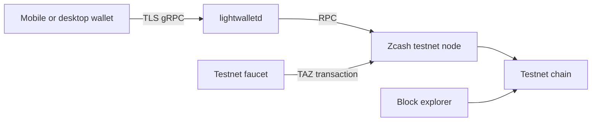
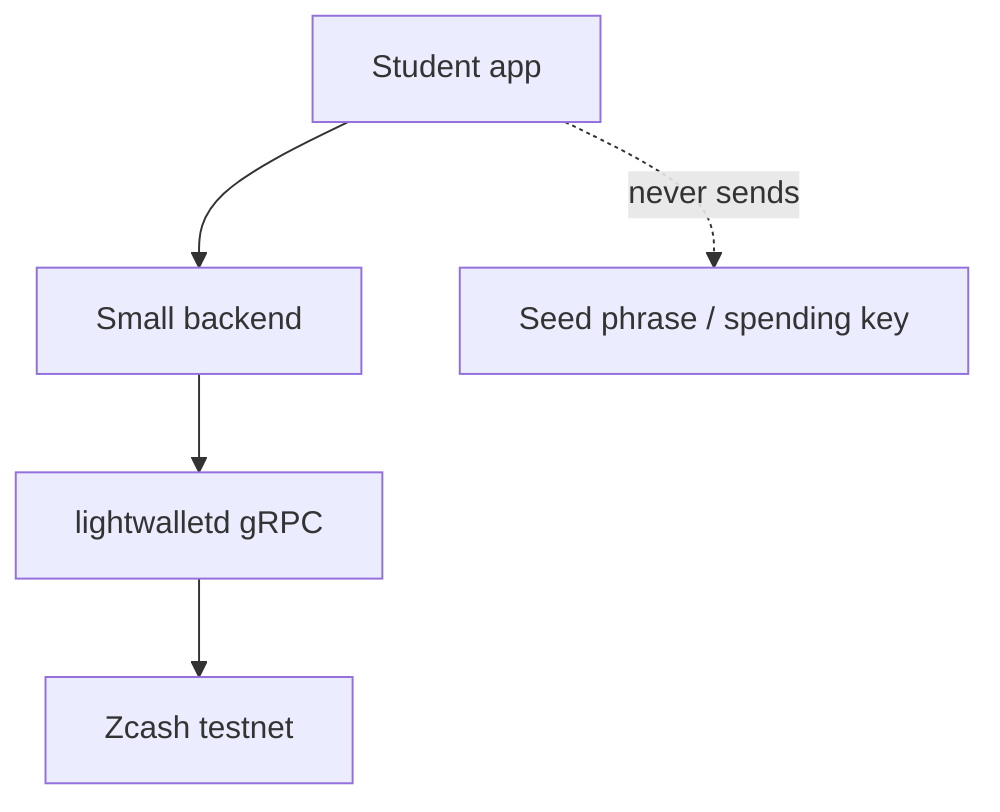

# Architecture Diagrams

## Testnet wallet flow

The wallet asks lightwalletd for compact blocks and broadcasts transactions through the wallet service. Lightwalletd is not a replacement for consensus: the wallet verifies the relevant transaction and note commitments.

## Student application

Keep the backend read-only when possible. If a prototype broadcasts transactions, use a wallet library designed for that purpose and document who controls keys.

