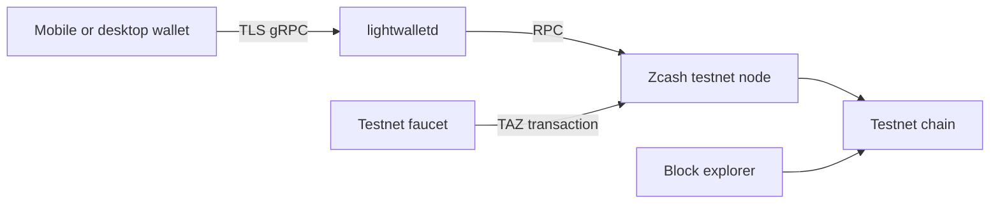
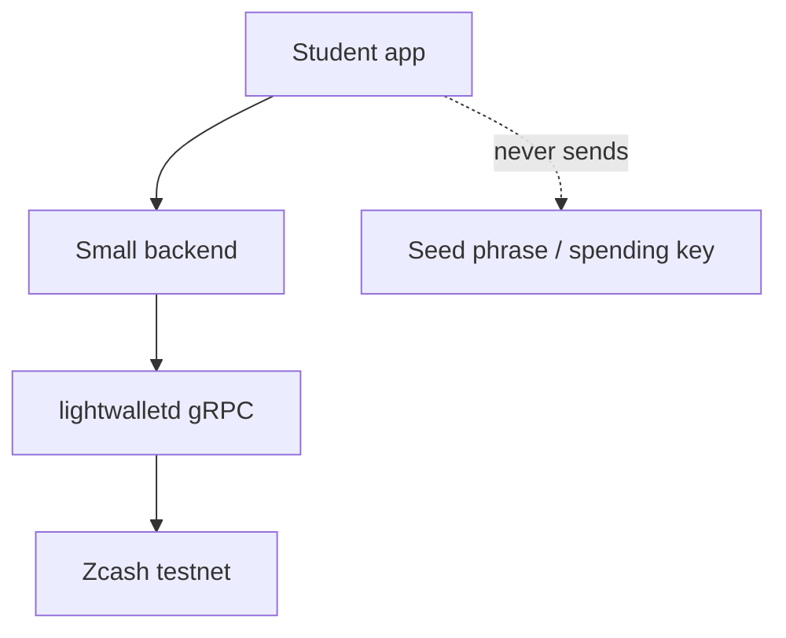

# Architecture Diagrams

## Testnet wallet flow

The wallet asks lightwalletd for compact blocks and broadcasts transactions through the wallet service. Lightwalletd is not a replacement for consensus: the wallet verifies the relevant transaction and note commitments. Student devices must use TLS. An insecure lightwalletd process is only for a facilitator loopback (`127.0.0.1`) node.

## Student application

Keep the backend read-only when possible. The default classroom prototype is the Node.js starter, which only calls `GetLightdInfo`, `GetLatestBlock`, and `GetBlockRange`. If a prototype broadcasts transactions, use a wallet library designed for that purpose and document who controls keys.

